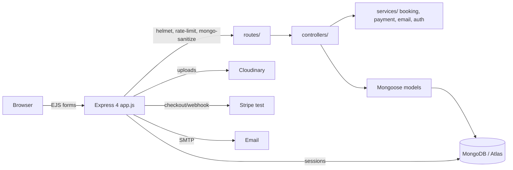

# LuxeStay ✨

A rental platform: browse listings, book stays, pay (Stripe test mode, or clearly-labelled demo payment when keys are missing), review completed stays, and manage listings as a host or moderator as an admin.

**Live URL: TBD — not publicly deployed yet.** The code has been pushed to GitHub (main @ `73b28f4`, CI green — see Verified below), but no public hosting is attached yet; see [Deployment](#deployment) for the exact steps once accounts/keys are available.

## Screenshots / GIF

> **No screenshots are included yet, and none are faked here.** These are placeholders to be replaced with real captures from the live deploy. Do not treat the descriptions below as images.

- `[Screenshot: listings page — to capture]` — Search bar + filters, listing cards with skeleton image placeholders, persisted wishlist hearts, real average ratings.
- `[Screenshot: listing detail + booking form — to capture]` — Amenities, guests, price preview with 18% GST, booking dates.
- `[Screenshot: guest trips — to capture]` — Booking status, demo-payment badge when Stripe keys are missing.
- `[Screenshot: host dashboard — to capture]` — Own listings, bookings, real vs demo earnings split.
- `[GIF: booking flow — to capture]` — Signup → search → book → demo-pay → host completes → guest reviews.

## Tech stack

- **Backend/UI:** Node.js ≥ 18, Express 4, EJS (server-rendered, Bootstrap, mobile-first CSS)
- **Database:** MongoDB + Mongoose 7 (Atlas free tier for production, local Mongo or Docker for dev, mongodb-memory-server for integration tests)
- **Auth:** Passport session auth + passport-local-mongoose (hashed passwords), roles `guest` / `host` / `admin`
- **Images:** Cloudinary via multer 2.x (falls back to an image URL or placeholder when keys are absent; never local disk in serverless)
- **Payments:** Stripe Checkout + webhook (test mode only) or labelled demo payment
- **Email:** Nodemailer (SMTP)
- **Validation:** Joi on every form endpoint · **Security:** helmet, rate limiting on auth, mongo-sanitize, secure/sameSite cookies in production
- **Tests:** Node's built-in test runner (unit, no DB) + integration flow (in-memory Mongo) · **CI:** GitHub Actions (install, test, syntax-check)

## Features

- Signup / login / logout (POST logout), protected routes, owner-only edit/delete, admin-only moderation
- Listings CRUD with Cloudinary images, category, amenities, max guests, price, location
- Server-side search: text/location, price range, guests, category, amenities, sorting, pagination (9 per page), working search bar + filters, empty state
- Bookings: date picker, nights + 18% GST price preview, double-booking prevention (overlap query + service logic), status `pending → confirmed → completed`, cancellation
- Payments: Stripe Checkout + webhook when keys are present; otherwise a clearly-labelled **demo payment** (booking confirmed with `paymentStatus: "demo"`, UI badge “Demo mode — no real payment taken”, demo earnings kept separate from real earnings)
- Reviews only for completed bookings, one review per booking, author/admin-only delete, real average rating (no hardcoded stars)
- Guest: My Trips, Wishlist (persisted hearts on the listings grid and detail page) · Host: dashboard with listings, bookings, real vs demo earnings · Admin: users, listings, bookings moderation
- UI: clean typography, consistent spacing, card hover states, skeleton image shimmer while listing images load, empty/error states, focus-visible outlines, mobile-first responsive (stacked search/cards under 768 px)
- Privacy / Terms pages (footer links no longer 404)

## Setup

```bash
git clone https://github.com/Ganesh-123-maker/LuxeStay
cd LuxeStay
cp .env.example .env   # fill in MONGO_URL and SESSION_SECRET at minimum
npm install
npm run seed           # demo users + listings + one completed booking (see below)
npm start              # http://localhost:3000
npm test               # unit tests (no DB)
npm run test:integration  # full HTTP flow against in-memory MongoDB
```

Docker (app + Mongo):

```bash
docker compose up --build
# then, in another terminal: docker compose exec app npm run seed
```

> Docker build was **not** verified in this environment (no Docker daemon here) — see "Not verified" below.

## Environment variables

| Variable | Required | Purpose |
| --- | --- | --- |
| `MONGO_URL` | **Yes** | MongoDB connection string (Atlas or local). App fails fast without it. |
| `SESSION_SECRET` | **Yes in production** | Session secret. Dev-only warning if missing in development; production refuses to start without it. |
| `CLOUD_NAME`, `CLOUD_API_KEY`, `CLOUD_API_SECRET` | No | Cloudinary uploads. Without them, uploads use memory storage and listings fall back to an image URL or placeholder. |
| `STRIPE_SECRET_KEY`, `STRIPE_WEBHOOK_SECRET` | No | Stripe Checkout + webhook. Without them, Trips offers a labelled demo payment (no real money). |
| `SMTP_HOST`, `SMTP_PORT`, `SMTP_SECURE`, `SMTP_USER`, `SMTP_PASS`, `SMTP_FROM` | No | Booking-confirmation email. Without them, the email is logged to the console in dev/demo and the UI says it was not sent. |
| `PORT`, `NODE_ENV` | No | Defaults: `3000`, `development`. |

Only `MONGO_URL` and `SESSION_SECRET` are required. Everything else degrades gracefully and says so in the UI — it never crashes and never fakes a payment or an email.

## Demo logins (demo-only — change after seeding)

Seeded by `npm run seed` (or `npm run seed:reset` to wipe first):

| Role | Username | Password |
| --- | --- | --- |
| Guest | `guest` | `Guest123!` |
| Host | `host` | `Host123!` |
| Admin | `admin` | `Admin123!` |

These are demo credentials, not production credentials. Rotate/change them before any public deployment.

## Routes (forms, server-rendered)

| Method | Route | Access |
| --- | --- | --- |
| GET/POST | `/listings`, `/listings/new`, `/listings/:id`, `/listings/:id/edit` | Public read; create/edit/delete logged-in, owner-only (admin may manage) |
| POST | `/listings/:id/bookings` | Logged-in |
| POST | `/bookings/:id/cancel`, `/confirm`, `/complete`, `/pay` | Guest/host/admin as appropriate; `/pay` is Stripe when configured, demo otherwise |
| POST | `/listings/:id/reviews`, DELETE `/listings/:id/reviews/:reviewId` | Logged-in; review requires a completed booking |
| GET | `/trips`, `/wishlist`, `/dashboard` | Logged-in |
| POST | `/listings/:id/wishlist` | Logged-in |
| GET/POST | `/admin`, `/admin/users`, `/admin/listings`, `/admin/bookings` | Admin only |
| POST | `/webhooks/stripe` | Stripe webhook (raw body) |
| GET | `/privacy`, `/terms` | Public |

## Architecture



```
app.js                # fail-fast DB connect (cached for serverless), helmet/rate-limit/sanitize, webhook (raw body first), routes, central error handler
api/index.js          # Vercel serverless entry: ensureDb + configureApp, clean 500 if env missing
routes/               # listing, review, user, booking, admin
controllers/          # listings, reviews, users (trips/wishlist/host dashboard), bookings, admin
services/             # bookingService (nights/GST/overlap — pure, tested), authorization (pure, tested),
                      # paymentService (Stripe, key-gated), emailService (SMTP, key-gated)
models/               # Listing, Review, Booking, User — indexed search/booking fields
middleware.js         # isLoggedIn, isOwner (null-safe), isAdmin, Joi validators
views/                # EJS: listings, users, dashboard, admin, pages
init/                 # seed script (MONGO_URL, --reset only wipes)
vercel.json           # Vercel serverless config (see Deployment)
render.yaml           # Render web-service config (recommended for production)
```

## Deployment

**Live URL: TBD.** Nothing has been deployed from this work and no live URL is claimed.

### Option A — Vercel first (serverless Express, `vercel.json` + `api/index.js`)

What was done to make this plausible, and what will break if it is not done:

- `api/index.js` wraps the Express app, caches the Mongoose connection across warm invocations (`ensureDb`), and returns a clean 500 (not a buffering hang) when `MONGO_URL`/`SESSION_SECRET` are missing.
- Sessions use `connect-mongo`, **not** an in-memory store, so cold starts do not log users out.
- Uploads never use local disk: Cloudinary storage streams to Cloudinary, and without Cloudinary keys multer 2.x uses memory storage (the file is discarded and the image URL/placeholder is used).
- `vercel.json` rewrites all routes to `api/index.js` and includes `views/**` and `public/**` in the function bundle.

Exact steps:

1. Push the repo to GitHub, import it in Vercel as a Node project.
2. Set env vars in Vercel: `MONGO_URL` (Atlas, with Network Access `0.0.0.0/0` — Vercel has no fixed IPs), `SESSION_SECRET`, plus optional `CLOUD_*`, `STRIPE_*`, `SMTP_*`.
3. Deploy. If a request times out, see the caveats below — that is the signal to use Render instead.

Vercel caveats (why it is not the recommended default): function timeouts (10 s on Hobby, 60 s on Pro) can cut off slow uploads/queries, cold starts add latency on the first request after idle, and a traditional session + EJS monolith gains nothing from serverless scaling. It is workable, but it is the fragile option for this stack.

### Option B — Render (recommended for production, `render.yaml`)

1. Push the repo to GitHub, create a Render **Web Service** from it (or apply `render.yaml` as a Blueprint).
2. Build command `npm ci`, start command `node app.js`.
3. Set the same env vars as above in Render (Render can generate `SESSION_SECRET` for you; `render.yaml` already declares it as `generateValue`).
4. Deploy, then run the seed once against the production `MONGO_URL` from a machine with the env set (`npm run seed` — do **not** use `--reset` on production data).

Render is recommended because it is a long-lived server: no cold starts, no function timeout on uploads, one persistent DB connection, and sessions in Mongo survive restarts.

## What was fixed in this pass (audit → build → update)

- App now awaits the DB before listening and fails fast with a clear message when `MONGO_URL` is missing; the DB URL is no longer logged.
- No production session-secret fallback; `SESSION_SECRET` is required in production.
- Null guards + `return` after redirect in `showListing`, `renderEditForm`, `isOwner`, `isReviewAuthor`; `validateListing` added to POST `/listings`; file guard in `createListing`; signup `next` bug fixed; logout moved to POST.
- Removed `classroom/` dead tutorial code; fixed the README clone URL; renamed package from `majorproject` to `luxestay`; added `test`/`seed`/`test:integration` scripts.
- Search, ratings, wishlist, tax display are now server-driven; hardcoded "⭐ 4.8" is gone.
- Added bookings, Stripe (key-gated, plus labelled demo payment), email (SMTP-gated, console-logged in dev/demo), dashboards, admin, roles, wishlist persistence, and tests.
- **Update pass:** `vercel.json` + `api/index.js` (cached Mongoose, Mongo sessions, disk-free uploads) and `render.yaml` (both included, Render recommended); premium CSS (skeleton shimmer, wishlist hearts, focus states, mobile-first); multer upgraded 1.x → 2.5.0; Node engine `>=18` (no exact pin); integration flow against in-memory MongoDB.
- **Dependencies / audit:** `npm audit` could **not** run here — the registry returned `403 Forbidden, policy_denied` for the audit endpoint, so no clean-audit claim is made. `npm install` produced no vulnerability warnings in this environment. The old multer 1.x deprecation/vulnerability warning is gone after the 2.x upgrade; remaining risk to re-check on a machine with audit access is the old `cloudinary@1.41.3` / `mongoose@7.8.9` line (kept deliberately to avoid destabilising the EJS app — upgrade them as a separate, tested change, not blindly).

## Verified / not verified (exact, no invented numbers)

- **Verified:** unit tests 11/11; integration flow 1/1 against in-memory MongoDB — signup, explicit logout + login, listing creation (image-URL fallback, no Cloudinary keys), search/filter + empty state, wishlist persistence, booking, double-booking rejection, demo payment (labelled, no real money), host complete, review after completed booking with computed ⭐ 5 average, second-booking cancellation, host dashboard, admin rejection for a non-admin, anonymous listing creation rejected to `/login`.
- **Verified:** `node --check` on every JS file; fail-fast without `MONGO_URL`; Vercel entry returns a clean 500 without `MONGO_URL`; all 15 EJS templates render with mock data; mongo-sanitize strips `$where`; auth rate limiter returns 429 over its limit.
- **Verified — live local smoke test, 12/12 PASS (`scripts/smoke.sh`, `BASE_URL` defaults to `http://127.0.0.1:3000`):** run 2026-10-29 against a locally running server (mongod 8.2.6, seeded without `--reset`: 29 listings + 1 completed booking/review) — guest/host/admin login → 302, anonymous listing create → `/login`, non-admin `/admin` → 302, admin `/admin` → 200, listing creation with fallback image URL + search, booking 2 nights @ ₹1000 = ₹2,360 on `/trips` (₹2,000 + 18% GST), overlapping booking rejected (still 1 booking), demo payment badge shown (no Stripe keys), host dashboard with real vs demo earnings, review after completed booking appearing with ⭐ 5. Script exit code 0. This was a local live run only — public tunnels were blocked (localtunnel produced no URL, cloudflared not installed, localhost.run connection reset), so the live URL remains TBD.
- **Verified — GitHub Actions CI, green:** run **40915172229** on `main` @ `73b28f4`, started 2026-10-29T16:48:26Z, job `test` (ID 123593362481) in 17s — `npm ci`, `npm test`, and `node --check` all passed. Warnings only: Node 20 deprecated on runners, `ubuntu-latest` migration notice. CI covers unit tests + syntax checks; the in-memory integration flow was verified locally, not in CI.
- **Not verified:** real Stripe payment, real SMTP delivery, real Cloudinary upload, real Vercel/Render deploy (live URL TBD until public hosting is attached), Docker build (no daemon here), Lighthouse scores (none measured, none claimed), mobile widths in a real browser (CSS is mobile-first and was rendered as HTML, but no live browser responsive check was run here).
- **No secrets were found in git history** in the audit (no `.env` or Atlas credential string in history diffs). The live risks fixed were the session-secret fallback and DB-URL logging — rotate `SESSION_SECRET` if it was ever shared.

## What I learned

- A server that prints "running" before its database connects will look healthy while every route hangs on driver buffering — await the connection and fail fast.
- Redirect-without-return is a crash in disguise: every early redirect in a controller/middleware needs a `return`.
- Key-gated integrations (Stripe/SMTP/Cloudinary) should degrade honestly — pending/demo + a clear message — rather than faking success.
- For a session-based Express monolith, a long-lived host (Render) is the reliable default; serverless (Vercel) is possible only with a cached DB connection, Mongo-backed sessions, and disk-free uploads.
